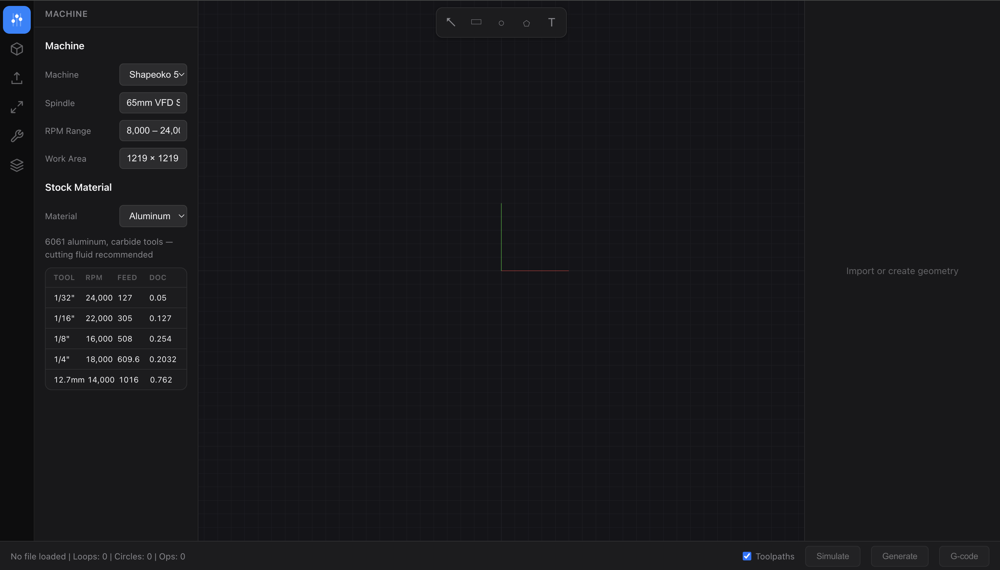
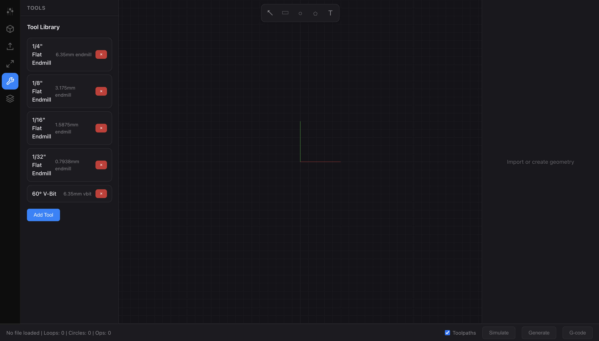
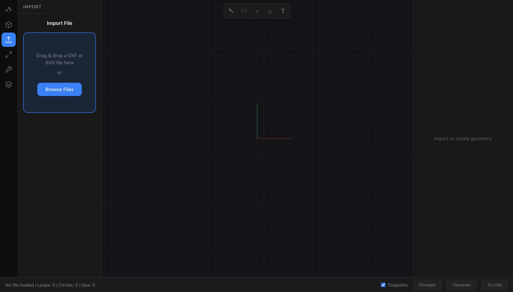

# CAM

CAM is an open-source browser application for CNC work. It converts DXF and SVG files to GRBL-compatible G-code.

## Why I made CAM

I built CAM because I hate Carbide 3D software. I needed a small application that works for my purposes.

CAM gives me one clear process:

1. Import a design.
2. Set the stock and tool data.
3. Make a toolpath.
4. Examine the cut.
5. Export the G-code.

CAM is fully open source under the [MIT License](LICENSE). You can use, copy, change, and distribute it.

## Interface



Use the machine panel to set the machine, spindle, work area, and stock material.



Use the tool library to select or add an end mill or V-bit.



Import a DXF or SVG file. You can also make simple geometry in the workspace.

## Functions

- Import DXF and SVG geometry.
- Find closed contours and editable regions.
- Make contour, pocket, and drill operations.
- Set the stock, machine, and tool data.
- Make depth passes and put toolpaths in order.
- Show geometry and toolpaths in a Three.js viewport.
- Simulate material removal in a Web Worker.
- Export GRBL-compatible G-code.

## Installation

CAM requires Node.js 22 or a newer version.

```bash
git clone https://github.com/OneManLabs/cam.git
cd cam
npm ci
npm run dev
```

Open the address that Vite shows.

## Standard operation

1. Import an SVG or DXF file.
2. Set the stock dimensions and the work origin.
3. Select or make a cutting tool.
4. Select the geometry.
5. Add the machining operations.
6. Make and examine the toolpaths.
7. Run the simulation.
8. Export the G-code.

## Development checks

Run these commands before you submit a change:

```bash
npm run lint
npm test
npm run build
```

For more technical data, read [PROJECT.md](PROJECT.md).

## Safety

> [!WARNING]
> Incorrect G-code can cause injury. It can also damage the machine or the material.

Before each cut, do these steps:

1. Make sure that the units and origin are correct.
2. Make sure that the tool data is correct.
3. Make sure that the feeds, speeds, and clearances are correct.
4. Examine the G-code and the simulation.
5. Do a dry run with the spindle off.

CAM is experimental software. It has no warranty.

## Contributions and security

Read [CONTRIBUTING.md](CONTRIBUTING.md) before you make a large change. Report security problems as specified in [SECURITY.md](SECURITY.md).

## License

CAM uses the [MIT License](LICENSE). Copyright 2026 One Man Labs.
